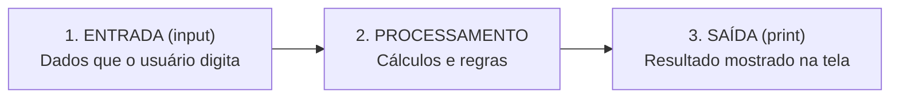

# Fundamentos: O Que é um Programa, Como o Python Funciona e Como Executar (`01-o-que-e-python-fundamentos.md`)

Se você está começando do **zero absoluto**, leia este guia antes de iniciar o Módulo 01. Aqui vamos do concreto (o arquivo no seu computador e o terminal) até os blocos fundamentais de qualquer programa em Python.

---

## 1. O Que é um Programa de Computador?

Um computador não "adivinha" o que você quer: ele apenas segue ordens exatas, uma após a outra.
Um **programa** nada mais é do que uma **lista de instruções escritas passo a passo** (um *algoritmo*) que diz ao computador:
1. Quais dados pedir ou ler (**Entrada**);
2. Quais contas ou decisões tomar (**Processamento**);
3. Qual resultado mostrar na tela (**Saída**).

---

## 2. O Que é um Arquivo `.py`?

Quando escrevemos um texto comum, salvamos como `.txt` ou `.docx`.
Quando escrevemos instruções na linguagem **Python**, salvamos em um arquivo de texto simples que termina com **`.py`** (por exemplo: `ex001_boas_vindas_soma.py`).

- **Regra de ouro para nomes de arquivos `.py`:** Use sempre letras minúsculas, sem acentos e separando palavras com sublinhado `_` (*snake_case*), como `calculadora_media.py`. Nunca use espaços no nome do arquivo!

---

## 3. O Que é o Terminal e Como Executar um Arquivo `.py`?

O **Terminal** (chamado de *PowerShell* ou *Prompt de Comando* no Windows) é a janela onde você pede para o Python ler e executar o seu arquivo `.py`.

Quando você digita no terminal:
```powershell
python modulos/01-introducao-e-variaveis/exemplos/exemplo_01_variaveis_e_tipos.py
```
*(ou `py ...` no Windows)*, o programa do Python abre esse arquivo, lê as instruções de cima para baixo, linha por linha, e mostra o resultado na tela.

---

## 4. Entrada, Processamento e Saída (O Modelo E-P-S)

Todo programa que você vai construir nos primeiros módulos segue esta estrutura de 3 blocos:



---

## 5. Variáveis e Memória: Como o Computador Guarda Informações?

Para que o computador não esqueça o que o usuário digitou na linha 1 quando chegar na linha 2, nós guardamos cada informação em uma **variável**.

Pense na memória do computador como uma estante cheia de **caixas organizadoras com etiquetas**:
```python
nome_cliente = "Gabriel"
quantidade_itens = 3
preco_unitario = 12.50
```
- O sinal `=` em programação **não significa "igualdade matemática"**: ele significa **atribuição** (*"pegue o valor da direita e guarde dentro da caixa da esquerda"*).

---

## 6. Os 4 Tipos Básicos de Dados em Python

O Python diferencia o que é texto do que é número para saber quais operações são permitidas:

| Tipo no Python | Nome | Como escrever | Exemplo de Uso |
| :--- | :--- | :--- | :--- |
| **`str`** | Texto (*String*) | Sempre entre aspas `""` ou `''` | `nome = "Maria"`, `cep = "29000-000"` |
| **`int`** | Número Inteiro | Sem aspas e sem parte decimal | `idade = 25`, `quantidade = -3` |
| **`float`** | Número Decimal | Sem aspas e usando **ponto `.`** | `altura = 1.75`, `preco = 19.90` |
| **`bool`** | Lógico (*Booleano*) | Apenas `True` ou `False` (primeira letra maiúscula) | `tem_desconto = True`, `esta_bloqueado = False` |

> **Atenção (Olhar de QA):** Para o Python, `"10"` (entre aspas, `str`) é um texto, enquanto `10` (sem aspas, `int`) é um número! Se você fizer `"10" + "10"`, o Python junta os textos formando `"1010"`. Se fizer `10 + 10`, ele soma matematicamente resultando em `20`.

---

## 7. O Que é Indentação (Os 4 Espaços)?

Em Python, o recuo de **4 espaços** no começo da linha não é apenas estética: é assim que o Python sabe quais linhas estão **dentro** de um bloco (como dentro de `def main():`).

```python
def main() -> None:
    # Estas linhas têm 4 espaços à esquerda, logo pertencem à função main()
    mensagem = "Olá, Python!"
    print(mensagem)
```
Se uma linha tiver 3 espaços e a seguinte tiver 5 espaços, o Python avisa com um erro chamado `IndentationError`.

---

## 8. Como Ler Mensagens de Erro (*Tracebacks*) Sem Pânico

Errar faz parte do aprendizado! Quando algo dá errado, o Python mostra um *Traceback* no terminal indicando:
1. **Em qual arquivo e linha** o problema aconteceu (`File "...", line 12`);
2. **Qual foi o tipo do erro** na última linha:
   - `SyntaxError`: Faltou fechar parênteses `)`, aspas `"` ou colocar `:` no final de `def`/`if`.
   - `NameError`: Você digitou o nome de uma variável que não existe (ex.: criou `valor_total` e escreveu `valor_tota`).
   - `TypeError`: Tentou somar um texto (`str`) direto com um número (`int`).
   - `ValueError`: Tentou converter um texto inválido para número (ex.: `int("abc")` ou `float("1,5")` com vírgula).

---

## 9. Entendendo um Pouco Mais (Seção Opcional)

À medida que você conversar com outros desenvolvedores ou ler vagas de tecnologia e QA, verá estes termos sobre o Python:
- **Linguagem Interpretada:** Você não precisa transformar o código manualmente antes de rodar; o próprio interpretador do Python lê e executa o arquivo `.py` na hora.
- **Linguagem de Alto Nível:** Os comandos são próximos do inglês humano (`print`, `input`, `if`, `in`), e você não precisa gerenciar detalhes físicos do processador.
- **Tipagem Dinâmica e Forte:**
  - *Dinâmica:* Você não é obrigado a declarar o tipo antes de criar a variável (`idade = 20` já reconhece que é `int`).
  - *Forte:* O Python não mistura tipos incompatíveis silenciosamente — ele não soma `"10" + 5` sem que você converta explicitamente com `int("10") + 5`.
- **Onde o Python é utilizado?** É amplamente utilizado em **Automação de Testes e Qualidade (QA)** (com `pytest`, Playwright, Selenium), Ciência de Dados, Inteligência Artificial, Desenvolvimento Web e scripts de automação.
